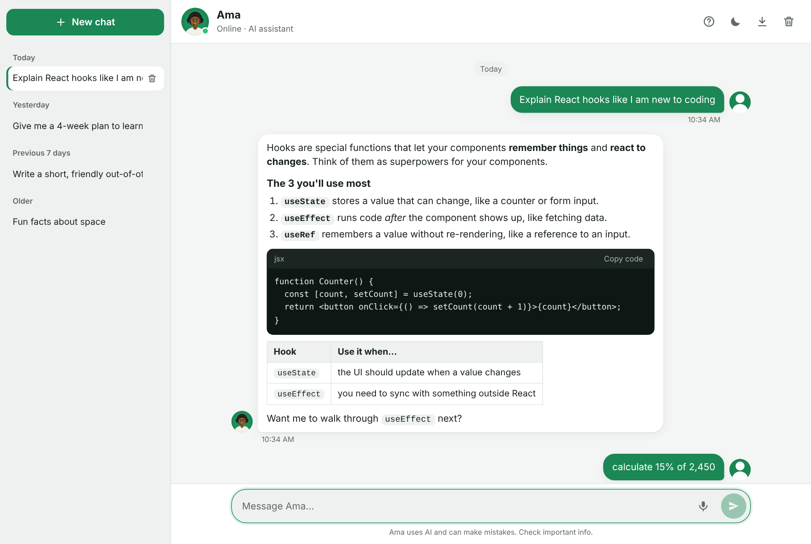
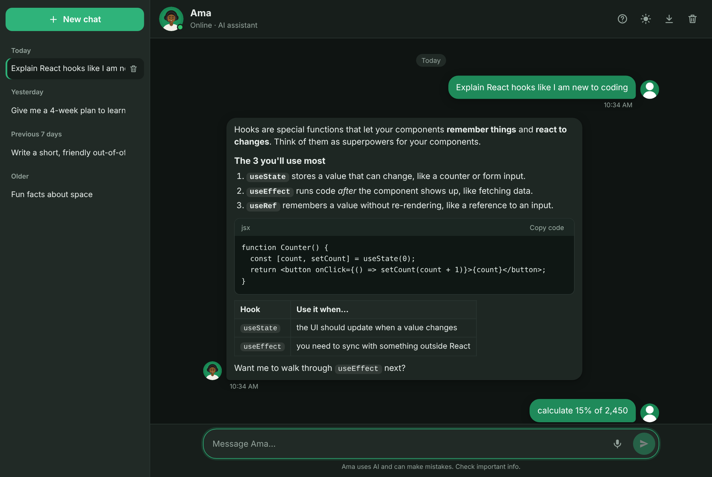
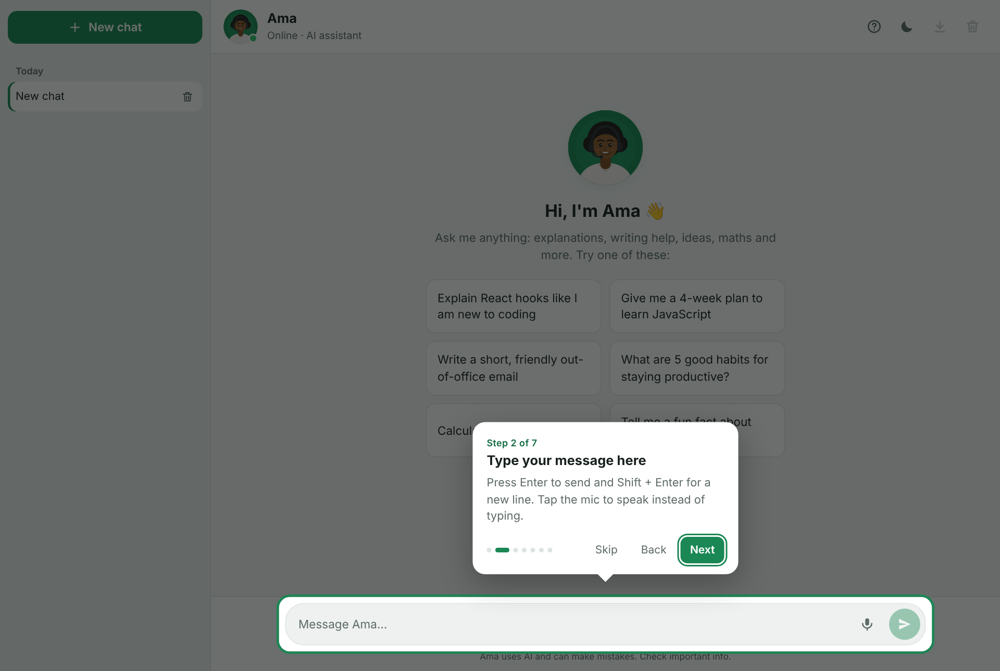
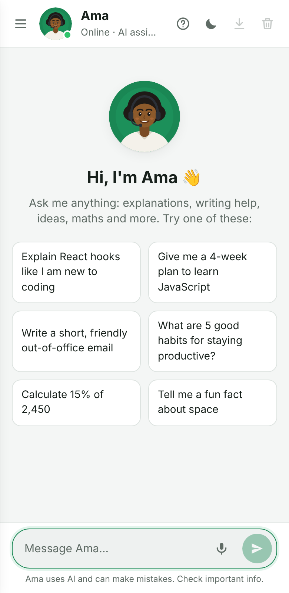
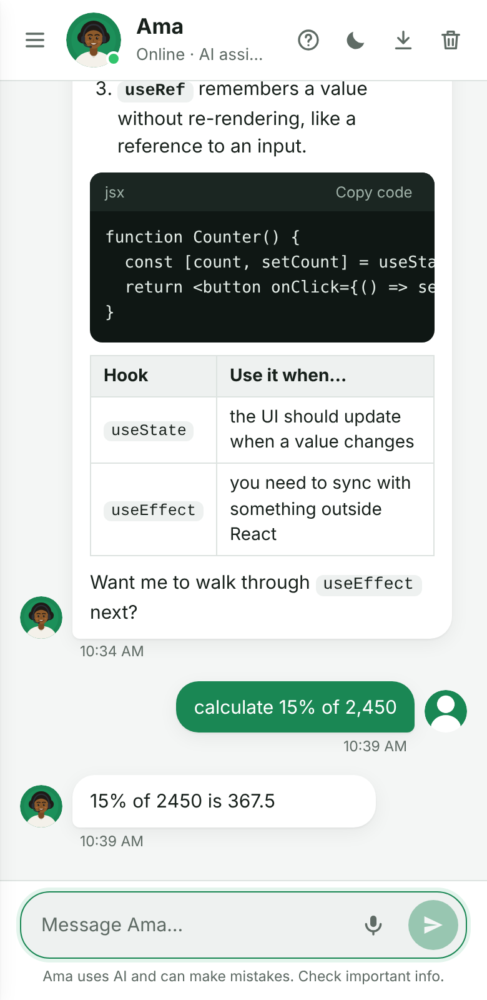
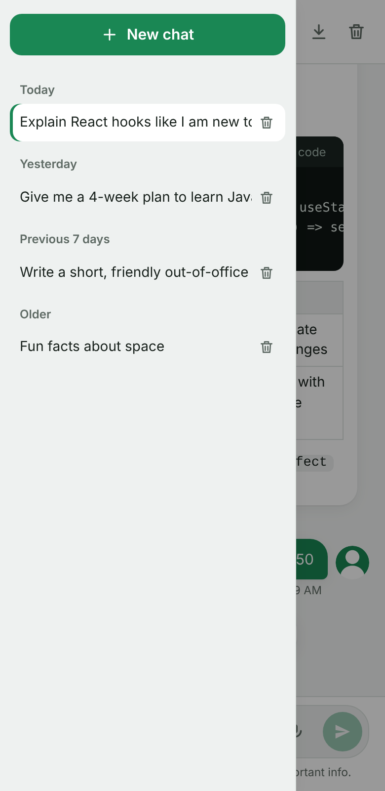

# Chat with Ama 💬

An AI chat assistant built with React, Vite and Express, powered by Google Gemini. It streams replies in real time, keeps multiple conversations, and still works offline with built-in skills when no AI key is set.



## Screenshots

| Dark mode | Guided tour for first-time users |
| :---: | :---: |
|  |  |

| Mobile: welcome | Mobile: chat | Mobile: conversations |
| :---: | :---: | :---: |
|  |  |  |

## Features

**AI**
* Real AI answers from Google Gemini (model configurable in `.env`)
* Replies stream in word by word, with a **Stop** button (or press `Esc`)
* **Regenerate** the last answer, or **Retry** after an error
* Remembers the conversation context (last 30 messages)
* Knows your current date and time zone

**Chat experience**
* Guided tour for first-time users (replay any time with the **?** button)
* Multiple conversations in a sidebar (grouped by Today / Yesterday / Previous 7 days)
* Markdown replies: lists, tables, links and code blocks with a **Copy code** button
* **Read aloud** (text-to-speech) and **voice input** (speech-to-text, Chrome/Edge/Safari)
* Download a conversation as a Markdown file
* Light and dark mode (follows your system by default)
* Everything is saved in your browser (localStorage)
* Responsive: the sidebar becomes a slide-in drawer on phones
* Keyboard and screen-reader friendly

**Instant built-in skills** (always exact, no AI needed)
* Maths: `12 * (3 + 4)`, `2^10`, `15% of 80`
* Time, date, coin flip, dice roll, random numbers
* In offline mode, also jokes, quotes and greetings

## Getting Started

### 1. Install

```bash
npm install
```

### 2. Add your free Gemini API key

1. Create a key at https://aistudio.google.com/apikey
2. Copy `.env.example` to a new file called `.env`
3. Paste your key:

```env
GEMINI_API_KEY=your-key-here
```

`.env` is in `.gitignore`, so your key is never committed. The key only lives on the server and is never sent to the browser.

> No key? The app still runs in **offline mode** with the built-in skills.

### 3. Run

```bash
npm run dev
```

This starts both the React app (http://localhost:5173) and the API server (http://localhost:3001). Open http://localhost:5173.

## How It Works

```txt
Browser (React)  ──POST /api/chat──▶  Express server  ──▶  Google Gemini
       ▲                                    │
       └──────── streamed reply (SSE) ◀─────┘
```

1. Exact skills (maths, time, date, dice, coin, random numbers) are answered instantly in the browser.
2. Everything else goes to `/api/chat`, which streams Gemini's reply back as Server-Sent Events.
3. If the server can't be reached, the bot falls back to its offline skills.

The server validates input, limits message size, rate-limits each user (15 messages a minute by default) and stops generating as soon as you press Stop or close the tab.

## Project Structure

```txt
server/
└── index.js              # Express API: /api/health, /api/chat (streaming)
src/
├── api/chatApi.js        # fetch + stream parsing
├── bot/botBrain.js       # offline skills, maths parser, suggestions
├── bot/tourSteps.js      # guided tour content (edit text/steps here)
├── hooks/
│   ├── useConversations.js
│   └── useLocalStorage.js
├── components/           # ChatHeader, Sidebar, ChatMessages, ChatMessage,
│                         # MarkdownMessage, TypingIndicator, QuickReplies, ChatInput, GuidedTour
├── App.jsx
└── main.jsx
```

## Configuration (`.env`)

| Variable | Default | Description |
| --- | --- | --- |
| `GEMINI_API_KEY` | none | Your Gemini API key. Without it, the app uses offline mode. |
| `GEMINI_MODEL` | `gemini-3.8-flash` | Any Gemini model available to your key |
| `PORT` | `3001` | API server port |
| `RATE_LIMIT_PER_MINUTE` | `15` | Max chat requests per user per minute |

## Deploying

The app needs a Node server (for the API key), so a static host such as GitHub Pages can only run offline mode. To deploy the full app as one service (for example on Render or Railway):

* **Build command:** `npm install && npm run build`
* **Start command:** `npm start`
* **Environment variable:** `GEMINI_API_KEY`

After `npm run build`, the Express server serves the React app and the API from the same URL.

## Built With

React 19 · Vite · Express 5 · Google Gen AI SDK (`@google/genai`) · react-markdown
